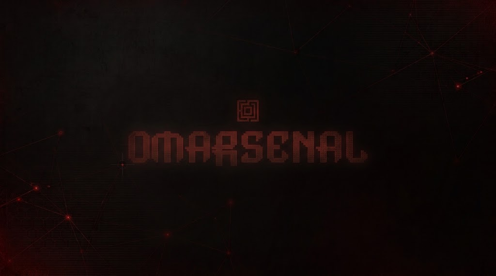

<p align="center">
  
</p>

# Omarsenal

An offensive and defensive security overlay for [Omarchy](https://omarchy.org).

Omarsenal is not a distro and not a fork. Install stock Omarchy, run one script, and get a curated pentest workstation with red, blue and purple ops modes, scope-guarded target profiles, and agent instructions for Claude Code and Codex.

> **Status: early scaffold.** The code is written but has not yet been tested end to end on a clean Omarchy install. See [docs/roadmap.md](docs/roadmap.md). Run it in a VM you can snapshot.

Omarsenal is an independent community project. It is not affiliated with or endorsed by Omarchy or Basecamp.

## Why

Kali and Parrot work, but everyone runs them the same way. Omarsenal keeps Omarchy's speed and tiling workflow, adds only the tools you pick, and changes how the machine behaves depending on whether you are attacking, defending, or both.

## Quick start

```bash
git clone https://github.com/AI-Gizmos/Omarsenal.git
cd Omarsenal
./install.sh --dry-run --recon --web   # preview
./install.sh --recon --web             # install
```

Install everything with `./install.sh --all`, or just the themes, keybinds and scripts with `./install.sh --theme-only`.

## Categories

| Flag | Tools |
| --- | --- |
| `--foundation` | Docker, tmux, build tools, scope-guard and logging dependencies (always included) |
| `--recon` | nmap, masscan, whois, dig, dnsrecon, amass, theHarvester |
| `--web` | Burp Suite, ffuf, gobuster, sqlmap, nikto, SecLists |
| `--exploitation` | Metasploit, searchsploit |
| `--passwords` | hashcat, john, hydra, SecLists |
| `--network` | Wireshark, tcpdump, Responder, Impacket |
| `--ad` | BloodHound, NetExec |
| `--blue` | Suricata, Zeek |
| `--workflow` | Obsidian |

Packages come from the official Arch repos and BlackArch first. The installer asks before anything comes from the AUR. Full list in [docs/tools.md](docs/tools.md).

## Ops modes

| Keybind | Mode | What changes |
| --- | --- | --- |
| `SUPER+ALT+R` | Red | Red theme, scope guard and session logging in new terminals, Waybar shows target and VPN IP |
| `SUPER+ALT+B` | Blue | Blue theme, detection services started, Waybar shows today's alert count |
| `SUPER+ALT+P` | Purple | Both at once, so you can watch your own attacks get detected |
| `SUPER+ALT+O` | Off | Services stopped, your previous theme restored |
| `SUPER+ALT+W` | Workspace | Terminal in the target folder, Burp and notes on workspace 9 |

From a terminal: `omarsenal-mode red|blue|purple|off|status`.

## Target profiles

```bash
omarsenal-target new acme        # creates ~/omarsenal-targets/acme
# fill in authorization.md (Status: APPROVED) and scope.txt
omarsenal-target use acme
omarsenal-target check
```

```
acme/
├── authorization.md    # who approved testing, window, contact
├── scope.txt           # in-scope IPs, CIDRs, hostnames, *.domains
├── out-of-scope.txt    # overrides scope.txt
├── profile.md          # running summary, kept current by your agent
├── recon/              # whois/, dns/, osint/, hosts.csv
├── scans/              # nmap/, services.csv
├── web/
├── findings/           # one file per finding
├── logs/               # auto-logged terminal sessions
├── notes.md
└── report/
```

In red and purple modes, `nmap` and `masscan` refuse to run until the active target is approved, and refuse any target outside its scope. Target folders live outside the repo and are git-ignored.

## AI agents

[AGENTS.md](AGENTS.md) teaches Claude Code, Codex and other agents how this repo works: building themes, adding tools the right way, and running recon inside a target profile without leaving scope. `CLAUDE.md` points to it.

## Labs

```bash
docker compose -f labs/docker-compose.yml up -d
```

Juice Shop on `127.0.0.1:3000` and DVWA on `127.0.0.1:8080`, bound to localhost only.

## Uninstall

```bash
./uninstall.sh --config   # scripts, themes, keybinds, shell hooks
./uninstall.sh --all      # plus every package Omarsenal installed
```

Packages that were on the system before Omarsenal are never removed.

## Safety

Only test systems you own or are authorized to test. Read [docs/safety.md](docs/safety.md).

## License

[MIT](LICENSE)
